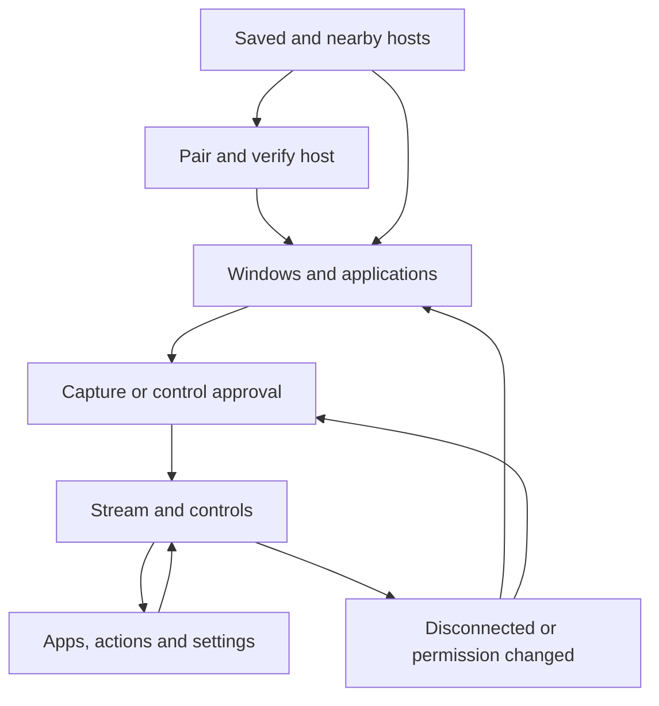

# Native client experience

Status: design draft. Closely adapt Sill's structure (D1); do not claim source-level reuse or UI parity before implementation and native verification.

## Screen flow

Edges to Library require authenticated remembered viewing access. Selecting an unpaired host always goes through Pair. Capturing a new source may open a host portal chooser even for paired devices.

## Screens and states

| Surface | Contents and behavior | Error/empty behavior |
| --- | --- | --- |
| Hosts | Saved tiles, nearby list, Add host/manual endpoint, verified identity status | No network permission: instructions + manual endpoint; host offline remains saved |
| Pair | QR scanner or explicit manual fallback; host fingerprint, device label, awaiting-host-approval | Wrong identity/expired QR/denied approval: explain and retry deliberately |
| Library | Running windows, launchable apps and separate independent-session section | Capture unsupported vs no windows vs access denied are distinct |
| Stream | Video, thumbnail strip, Apps drawer, keyboard, supported host actions, settings | Loading before first frame; permission pending; target closed; decoder recovery; link pressure |
| Control grant | Shared-desktop explanation, affected scope, request/release control | Host denied or busy stays view-only |
| Settings | This device: local zoom/layout/mute/gesture bindings; Host: negotiated quality and allowed host settings | Changes show pending/confirmed/rejected; rollback optimistic state on rejection |
| Permissions | Current view/control/audio/clipboard/menu grants and host approval status | Revoked controls disable immediately; no hidden automatic regrant |
| Managed session | Launch status, isolation description, stop session with confirmation | Startup failure/host crash/orphan cleanup has explicit status |
| Host details | Addresses, paired identity, forget, optional snapshots | Forget clears keys, previews and saved policy; host revocation is separately confirmed by host |

Host address entry is never a trust confirmation. A connected badge means authenticated transport; a live badge requires current decoded video. A preview/demo mode is explicitly labelled and cannot share state with a real host.

## Layouts

| Arrangement | Proposed structure |
| --- | --- |
| iPhone portrait | Picture above app/action bar, window strip, compact keys and trackpad; keyboard overlays lower input area without hiding disconnect/release |
| iPhone landscape | Picture-first with collapsible edge controls; optional trackpad overlay; controls respect safe areas |
| iPad wide | Picture-first, thumbnail/actions bar, app drawer; hardware keyboard/trackpad integration; optional laptop-style arrangement |
| iPad narrow / split view | Compact arrangement based on available dimensions, not device model |
| Accessibility large text | Scrollable control groups and named alternatives; picture may shrink, essential safety controls remain reachable |

Preserve Sill's Larger Picture intent while separating client layout from host resizing. Use actual keyboard/safe-area geometry; copied fixed-size heuristics require revalidation. Specialized foldable posture support is deferred.

## Gesture and keyboard ownership

Client-local picture pinch zoom (initial range 1–5x) never requests app zoom or host window resize. Every injected pointer position is inverse-transformed through the displayed picture. Host application zoom is a distinct optional semantic action.

One-finger direct interaction, virtual trackpad movement, two-finger scrolling and local pinch must arbitrate before emitting host input. Once a multi-finger desktop gesture claims a stroke, suppress its stray pointer/click/scroll events; cancellation emits no desktop action. System-reserved gestures and VoiceOver take precedence. All desktop actions have accessible button equivalents.

Suggested desktop gestures are offered only when negotiated: e.g. swipe -> workspace step, pinch -> launcher/overview if the host provides an equivalent. Host suggestions never silently overwrite user bindings. Show the resolved action name, not macOS-specific wording on Linux.

Hardware keyboard input goes to the host only while the stream is active, control is granted and remote input owns focus. Pairing, settings, menus and app drawer temporarily take local focus; release held host keys before transferring ownership. Returning focus does not replay buffered text. Keep physical keys, composed text and shortcut toolbar actions separate.

## Capabilities drive controls

- Always retain local Disconnect/Release control/Help regardless of host suggestions.
- Hide unsupported optional actions; show temporary unavailability with a concise reason where discoverability matters.
- When control is not granted, keep a Request control affordance and clearly mark viewing-only mode.
- Before close-window, indicate the exact target; application prompts remain visible through the stream.
- Minimize, maximize, fullscreen, tile width and fit-to-viewport are separate semantics. Niri-specific operations may appear as named extensions.
- Aa, if retained visually, opens a panel explaining its offered function. Never imply that video scaling changes application font size.
- Expose whole-desktop capture only as a distinct explicit selection; do not fall back after window capture fails.
- The independent-session badge states whether it provides only a separate display or a hardened security sandbox. Do not infer either from a virtual output.

## Privacy and interruptions

Clipboard directions default off. Device->host reads use explicit iOS paste UI; Paste Now additionally requires input permission. Incoming host clipboard is made available through an explicit user-facing flow under the grant; avoid unexpected overwrites of the device clipboard.

Opt-in saved snapshots carry a clear persistence description and Clear images control. App switcher protection, lock transitions and forget deletion are native acceptance checks.

On disconnect, label the last picture as frozen/disconnected or blank it; disable input and menus. On video revoke/forget, blank it and clear sensitive retained content. A recoverable decoder discontinuity may show Reconnecting picture without losing authenticated connection state. Audio mute is local and distinct from stopping host audio capture.
