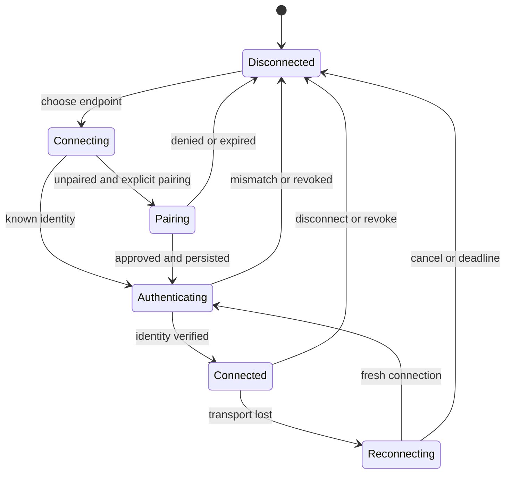
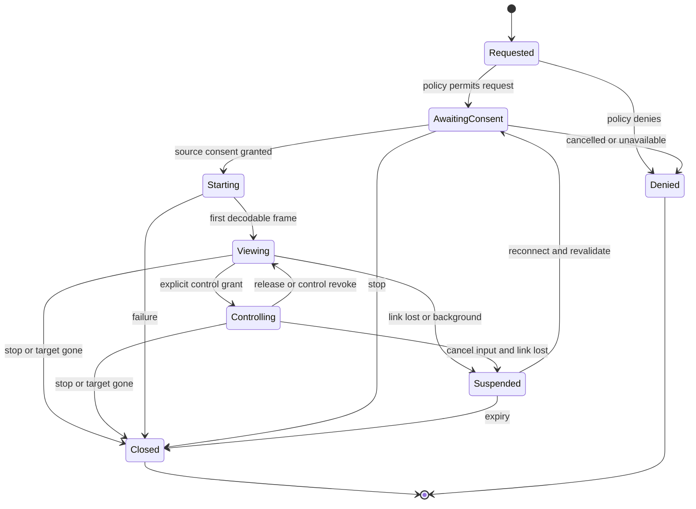

# Lifecycle, pairing and permission design

Status: proposed contract. Confirmed choices D2–D5 are in [README](README.md).

## Trust and pairing

Threats: discovery spoofing, active network interception, stolen/revoked device credentials, stale target IDs, replayed input, permission races, malicious payloads, privacy leaks and unsafe backend access. OS compromise, a fully compromised paired client and an unrestricted app launched under the host user's UID cannot be solved by transport encryption.

Proposed initial pairing path:
1. User explicitly opens a short-lived pairing window on the host.
2. Host displays a QR with endpoint hints, protocol version, host public-key fingerprint and a cryptographically random one-use 256-bit pairing secret. Proposed lifetime: two minutes. Never advertise the secret in mDNS or logs.
3. Client connects using TLS and validates the out-of-band host pin before sending the secret or device data. Validate the TLS handshake with the pinned public key; do not globally disable certificate validation or accept changed keys.
4. Host validates the secret with constant-time comparison and bounded attempts, atomically consumes it, and asks for local approval of the named new device. Names are untrusted text. Host records a client certificate public key for later mTLS authentication, returning the host identity and allowed policy. Keys prove possession via the TLS handshake on the next authenticated connection, not an unauthenticated public-key string.
5. Persist the client private key in iOS Keychain and host private key/trust database in user-restricted storage. Establish a fresh mutually authenticated connection before catalogs or sessions.

Manual fallback v1: enter endpoint plus full out-of-band host fingerprint and long pairing secret; cumbersome but avoids inventing short-code cryptography. A friendly numeric-code flow is deferred until a reviewed PAKE or another established authenticated design is selected. No trust-on-first-use shortcut or automatic wired pairing.

On identity change: stop, explain, require deliberate forget/re-pair. Rotation/recovery cannot silently inherit privileges. Lost host identity/trust database invalidates pairings. Rate limits, secret consumption, approval expiry and QR parsing require negative tests. Redact secrets, keys, clipboard text, titles and media from routine logs.

## Permissions

| Permission | Scope / default | Notes |
| --- | --- | --- |
| catalog.view | Paired host, remembered with explicit initial approval | Only policy-permitted metadata |
| video.view | Target/session; remembered policy where allowed | Every source still requires compositor/portal approval as needed |
| audio.listen | Target/session; initially off until explicitly granted | App-only vs whole-system scope visible |
| input.control | One target/session, approve each session | Shared desktop warning in existing-window mode |
| desktop.actions | Host desktop, separate explicit scope | Workspace/launcher actions can affect unstreamed windows |
| menus.read / menus.invoke | Application/session, explicit grant | Invocation requires corresponding control authorization |
| clipboard.read / clipboard.write | Host->client / client->host separately | Off until granted; explicit client paste access |
| application.launch | Allowlisted app/session target | No arbitrary shell/arguments |
| session.manage | Owned managed session only | Stopping session can terminate applications |

Remembered viewing trust authorizes a policy, not stealth capture or silent fallback to a desktop source. Portal denial leaves the session denied even when video.view is saved.

Permission changes increment grant_epoch. Revocation cancels worker output/input, releases held state, flushes media queues, and closes transport/media authorization before acknowledging completion. Data already delivered cannot be recalled. Client clears rendered sensitive content on terminal revoke and forget, including snapshots when applicable.

Control is a lease: one controller per target; initially one shared-desktop controller host-wide. Another controller receives busy and must request explicit host-approved transfer. An adapter unable to scope injected input to a window must declare shared_desktop scope and require matching grant; a window-only grant cannot be widened implicitly. Local activity can interrupt/revoke control using a host-visible stop command. Precise automatic local-activity arbitration is deferred pending backend evidence.

## State machines

Connection state is separate from trust, per-session permission and media state.

Granting control does not restart capture. Revoking video closes the stream; revoking input returns to viewing if viewing remains authorized. Host enforces first-frame gating before claiming Viewing.

## Disconnect, background and reconnect

Proposed transport heartbeat: every 2 s; lease expires after 6 s without valid liveness. Receipt of disconnect/revoke releases input immediately; host-side watchdog cleanup handles abrupt loss. Do not rely on the client sending key-up during a crash.

On loss: release input; blank or clearly freeze the current video with a disconnected overlay (never imply live); no new input queued. In foreground attempt reconnect for at most 30 s with bounded jittered backoff. New authenticated connection means new epochs, fresh snapshots and fresh media negotiation; no command or keystroke replay. A restarted control session needs host approval again (D4). Source consent may need repeating. Resume viewing is subject to host policy and fresh decoder sync, not a reused portal token from the client.

On iOS background: release control, suspend media/audio and stop clipboard activity. Do not promise persistent background streaming. Foreground follows reconnect/revalidation; keyboard ownership is reacquired only after new control grant and active stream focus.

Proposed managed-session lifetime: stop its remote control on disconnect; preserve app processes for 60 seconds for reconnection, then stop the managed session. Existing applications are never terminated by disconnect. An explicit Stop independent session confirmation describes process termination/unsaved-work risk. This grace period is a tunable policy proposal, not approved unattended persistence.

## Listener and authorization boundaries

No default public bind. Host operator explicitly enables LAN/Tailscale listening/interfaces and firewall reachability. Unpaired endpoints expose only bounded version/bootstrap responses during a host-open pairing window; mTLS/auth is required for operational data. Tailscale is connectivity, not a replacement for Vista identity.

Prevent old queued work from crossing epochs. Immediately before executing native actions, verify connection, target generation, grant, capability state and parameters again. Revoke/close invalidates all adapter handles. Host-visible session list and stop/revoke commands are required before shipping shared control.

Retain opt-in snapshots only on the client in app-private storage, excluded from backup where supported. Delete on forget, disable or explicit clear; blank previews in app switcher when sensitive state is visible. Define retention/lock behavior during native implementation and test it. No thumbnails saved by default.

## Standards and implementation gates

Use maintained TLS libraries and platform key storage. TLS 1.3: [RFC 8446](https://www.rfc-editor.org/rfc/rfc8446.html) and applicable current updates; WebSocket: [RFC 6455](https://www.rfc-editor.org/rfc/rfc6455.html). Final crypto/library selection requires a focused interoperability and security review; this document is not a new cryptographic protocol.

Before any network listener ships: verify pinning on iOS/Rust, mTLS proof and revocation, secret expiry/reuse rejection, resource limits, non-replayed side effects and host-visible revocation. No unauthenticated remote input.
